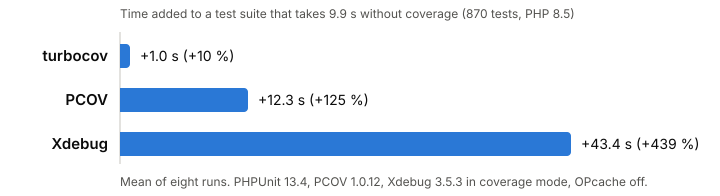

# turbocov

Line coverage driver for PHP. Covered code runs at the speed of plain PHP.

- It reports the same line data as [PCOV](https://github.com/krakjoe/pcov).
- A build option gives it the name, the functions and the settings of PCOV, for tools that only know PCOV.
- Files outside of the whitelist have no cost at run time.

Status: experimental. Read [Limits](#limits) before you use it.

## How it works

PCOV and Xdebug do work for each instruction that PHP executes. turbocov does work only when a line runs for the first time.

1. PHP compiles a file into opcodes. Each opcode has a pointer to its handler.
2. For a whitelisted file, turbocov replaces the handler of the first opcode of each line with a probe.
3. When a probe fires, it records the line and puts the original handler back. PHP then executes the same opcode again.
4. From that moment the line runs without a probe.
5. `clear()` arms the fired probes again. The cost of a test run is in proportion to the number of lines that the test touched.

turbocov does not replace the instruction loop of PHP. Code without probes runs as if the extension is not loaded.

## Performance



The test suite of a PHPStan extension (870 tests, PHPUnit 10.5, PHP 8.5, OPcache off), mean of five runs:

| Driver | Suite time | Added time |
|---|---|---|
| No coverage | 8.7 s | |
| turbocov | 9.7 s | +1.0 s (+12 %) |
| PCOV 1.0.12 | 20.8 s | +12.1 s (+140 %) |
| Xdebug, coverage mode | 47.4 s | +38.8 s (+447 %) |

- turbocov adds 12 times less time than PCOV and 37 times less time than Xdebug.
- The clover report of turbocov is identical to the report of PCOV.
- turbocov itself uses 0.08 s of the added 1.0 s: 1.6 million probe hits, the API calls and the compile hook. The coverage library of PHPUnit uses the rest, with each driver.

## Requirements

- PHP 8.4 or 8.5, non-thread-safe build.
- Linux or macOS.
- The CLI SAPI. OPcache can be on or off.

## Build

```sh
phpize
./configure --enable-turbocov
make
make test
```

Load the result with `extension=/path/to/modules/turbocov.so`.

## Settings

| Setting | Default | Description |
|---|---|---|
| `turbocov.enabled` | `1` | Set `0` to turn the extension off. It then has no effect at all. |
| `turbocov.collect_paths` | none | The files and directories that get probes. A directory includes all files below it. |
| `turbocov.exclude_paths` | none | The files and directories that get no probes. |
| `turbocov.exclude_pattern` | none | A PCRE pattern. Files with a matching path get no probes. |

The two path settings take one of these values:

- A list of paths with `:` between them: `src:config/services.php`.
- `@` and the name of a list file: `@changed.txt`. The list file has one path on each line.

Rules:

- A relative path starts at the working directory.
- turbocov ignores a path that does not exist.
- Without `turbocov.collect_paths` turbocov collects nothing, and the first call of `start()` gives a warning.
- The settings apply when PHP compiles a file. Set them in `php.ini` or with `-d`, not with `ini_set()`.

To collect coverage only for the files that a branch changes:

```sh
git diff --name-only --diff-filter=AMR origin/master...HEAD -- '*.php' > changed.txt
php -d turbocov.collect_paths=@changed.txt vendor/bin/phpunit
```

## Functions

```php
\turbocov\get_disabled_reason();     // null, or the reason why the collection is off
\turbocov\start();                   // start the collection
\turbocov\stop();                    // stop the collection; file => line => 1 for the lines that ran since start()
\turbocov\get_executable_lines(      // file => line => -1 for each executable line of the given files
    ['/absolute/path/File.php'],
);
\turbocov\get_debug_info();          // the state of the extension, for a person
\turbocov\get_debug_info(            // the state of one file, for a person
    '/absolute/path/File.php',
);
```

- `stop()` returns only the lines that ran. It also arms the probes again, so the next `start()` begins with no data.
- A file that PHP loaded during the collection is in the result of `stop()`, also when none of its lines ran.
- `get_executable_lines()` knows only the files that PHP compiled and that are in `turbocov.collect_paths`. Other files are not in the result.

A coverage tool needs the lines that did not run only once for each file:

```php
$executed = \turbocov\stop();
$newFiles = array_diff_key($executed, $seenFiles);

foreach (\turbocov\get_executable_lines(array_keys($newFiles)) as $file => $lines) {
    $executed[$file] = array_replace($lines, $executed[$file]);
    $seenFiles[$file] = true;
}
```

### Debug data

`get_debug_info()` is for a person who looks for the cause of a result. Its format can change in each version. Do not use it in a tool.

Without an argument it returns the state of the extension:

```php
[
    'disabled_reason'  => null,   // as get_disabled_reason()
    'collecting'       => true,   // true between start() and stop()
    'collected_files'  => 250,    // files that have probes
    'installed_probes' => 11189,  // since the start of the process
    'fired_probes'     => 275,    // since the start of the process
]
```

With a file it returns the probes of that file:

```php
[
    'skip_reason'      => null,   // or the reason why the file has no data
    'executable_lines' => [5, 6, 9],
    'units'            => [       // one for each function, method and closure
        [
            'name'   => 'Foo::bar',
            'probes' => [
                ['line' => 5, 'opnum' => 1, 'opcode' => 'ZEND_IS_SMALLER', 'state' => 'fired'],
                ['line' => 6, 'opnum' => 3, 'opcode' => 'ZEND_RETURN', 'state' => 'armed'],
            ],
        ],
    ],
]
```

- `skip_reason` tells if the file is not in `turbocov.collect_paths`, if an exclude setting has it, or if PHP did not compile it.
- `state` is `armed`, `fired` or `fired while the collection was off`.
- The code of a file outside of all functions has the name `{main}`. PHP destroys that code after it ran, so it is usually not in the list.

## Use with PHPUnit

PHPUnit selects its PCOV driver when an extension with the name `pcov` is loaded. Build turbocov with that name:

```sh
./configure --enable-turbocov --enable-turbocov-impersonate-pcov
```

The extension then registers as `pcov`. PHPUnit and all other tools that support PCOV work without a change.

- The functions are the functions of PCOV: `\pcov\start()`, `stop()`, `waiting()`, `collect()`, `clear()` and `memory()`. The functions of the section above do not exist in this build.
- The settings are `pcov.enabled`, `pcov.directory` (as `turbocov.collect_paths`) and `pcov.exclude` (as `turbocov.exclude_pattern`).
- `pcov.directory` has no default. PCOV uses `src`, `lib` or `app` when the setting is empty; turbocov collects nothing and gives a warning.
- Do not load the real PCOV at the same time.

## Limits

- OPcache: turbocov puts its probes into the code that OPcache caches. This is not possible with `opcache.protect_memory=1`, with `opcache.file_cache`, with the JIT, and in a SAPI other than the CLI. In these cases turbocov turns the collection off. `get_disabled_reason()` returns the reason, and the first call of `start()` gives a warning.
- OPcache optimizer: the optimizer can remove code, and a line without code is not executable. PCOV has the same behavior. Set `opcache.optimization_level=0` for line data that does not depend on the optimizer.
- Other extensions that replace the instruction loop (PCOV, phpdbg) make turbocov slow. The results stay correct.
- Xdebug: not tested together.
- No branch coverage, no path coverage, no detection of dead code.
- In the build with the name `pcov`, `clear(true)` does not drop the file list. The argument has no effect.

## Development

The scripts in `dev/` need Docker. They limit each container to 2 GB of memory.

```sh
RUN_TESTS=1 dev/build.sh 8.5                 # build and run the tests
dev/build.sh 8.5 pcov                        # build with the name pcov
dev/compare-with-pcov.sh 8.5 path/File.php   # compare the line data with PCOV
dev/bench.sh 8.5                             # compare the speed with plain PHP and PCOV
```
